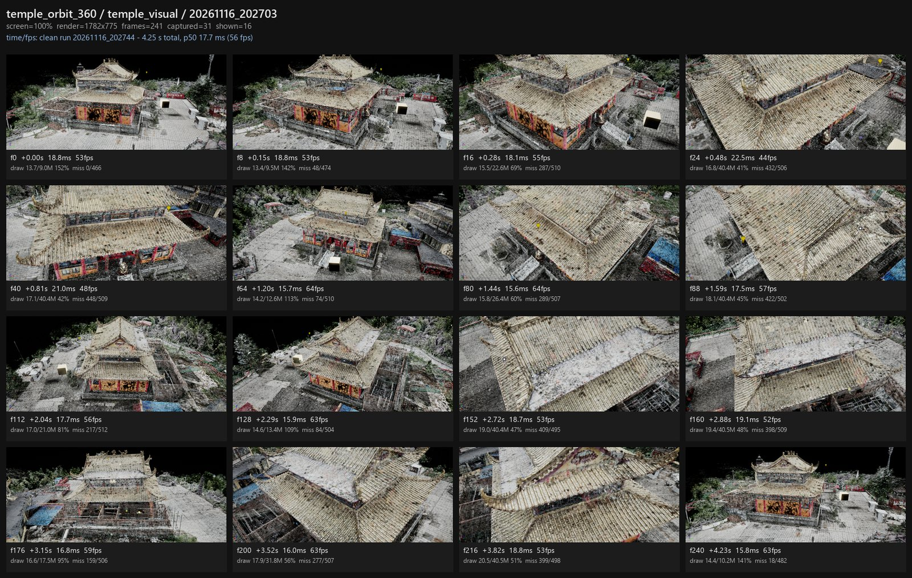

# temple_orbit_360 / temple_visual / 20261116_202703

## 这次 run 是什么

- 用例 `temple_orbit_360_visual`，档位 `visual`，轨迹 `temple_orbit_360`；屏幕百分比 100%，渲染 1782x775。
- 采样 241 帧（warmup 20 帧丢弃），每 8 帧截 1 张共 31 张。
- PICOSplat `e1d96e2`，Docs `613478d`。

## 时间与帧率

- 时间与帧率取自同 CI 的 clean run `20261116_202744`（无截图、无录像）：241 个采样帧共 **4.25 s**，
  `FrameTimeMs` p50 **17.8 ms** / p95 21.8 ms，即 p50 **56 fps**（均值 56 fps）。
- 拼图每一格的 `+x.xx s` 就是该帧在正常运动中的时刻；`ms` 与 `fps` 是该时刻的帧时间与帧率。

## 覆盖：想要的 splat 实际画了多少

- 全帧平均 `DrawnSplats` **16.9M** / `WantedSplats` **27.4M** = **74.5%**。
- 每帧平均 **263** 个前沿节点未驻留（p95 451，前沿规模均值 503）。
- `UncoveredFrontierNodes` 最大 **0**：没有整块区域连粗层都缺；画面上看到的黑色斑点是黑色背景从欠采样的 splat 缝里透出来。

## 拼图对应的 16 帧

| 帧 | 时刻 | 帧时间 | 帧率 | drawn / wanted | 未驻留 |
| ---: | ---: | ---: | ---: | --- | ---: |
| 0 | +0.00s | 18.8ms | 53fps | 13.7/9.0M (152%) | 0/466 |
| 8 | +0.15s | 18.8ms | 53fps | 13.4/9.5M (142%) | 48/474 |
| 16 | +0.28s | 18.1ms | 55fps | 15.5/22.6M (69%) | 287/510 |
| 24 | +0.48s | 22.5ms | 44fps | 16.8/40.4M (41%) | 432/506 |
| 40 | +0.81s | 21.0ms | 48fps | 17.1/40.4M (42%) | 448/509 |
| 64 | +1.20s | 15.7ms | 64fps | 14.2/12.6M (113%) | 74/510 |
| 80 | +1.45s | 15.6ms | 64fps | 15.8/26.4M (60%) | 289/507 |
| 88 | +1.59s | 17.5ms | 57fps | 18.1/40.4M (45%) | 422/502 |
| 112 | +2.04s | 17.8ms | 56fps | 17.0/21.0M (81%) | 217/512 |
| 128 | +2.29s | 15.9ms | 63fps | 14.6/13.4M (109%) | 84/504 |
| 152 | +2.72s | 18.7ms | 53fps | 19.0/40.4M (47%) | 409/495 |
| 160 | +2.88s | 19.1ms | 52fps | 19.4/40.5M (48%) | 398/509 |
| 176 | +3.15s | 16.8ms | 59fps | 16.6/17.5M (95%) | 159/506 |
| 200 | +3.52s | 16.0ms | 62fps | 17.9/31.8M (56%) | 277/507 |
| 216 | +3.82s | 18.8ms | 53fps | 20.5/40.5M (51%) | 399/498 |
| 240 | +4.23s | 15.8ms | 63fps | 14.4/10.2M (141%) | 18/482 |

## 文件

- `contact_sheet.jpg`：压缩到 1600 px 宽的 16 格拼图。
- `frames.csv`：逐帧数据（时刻、帧时间、帧率、drawn/wanted、未驻留、uncovered）。
