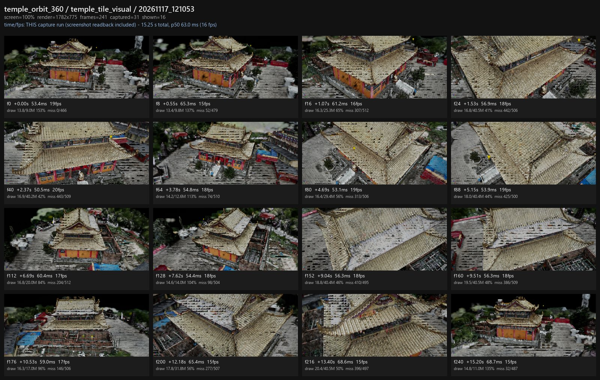

# temple_orbit_360 / temple_tile_visual / 20261117_121053

## 这次 run 是什么

- 用例 `temple_orbit_360_tile_visual`，档位 `visual`，轨迹 `temple_orbit_360`；屏幕百分比 100%，渲染 1782x775。
- 采样 241 帧（warmup 20 帧丢弃），每 8 帧截 1 张共 31 张。
- PICOSplat `e067a42`，Docs `596aa62`。

## 时间与帧率

- 时间与帧率取自同 CI 的 clean run `20261117_121216`（无截图、无录像）：241 个采样帧共 **9.38 s**，
  `FrameTimeMs` p50 **38.8 ms** / p95 46.6 ms，即 p50 **26 fps**（均值 26 fps）。
- 拼图每一格的 `+x.xx s` 就是该帧在正常运动中的时刻；`ms` 与 `fps` 是该时刻的帧时间与帧率。

## 与管线对比（同轨迹、同分辨率、clean）

| 路径 | FrameTime p50 | p95 | GPU p50 |
| --- | ---: | ---: | ---: |
| 管线 `temple_clean` | 17.6 ms | 21.6 ms | 11.1 ms |
| Tile 全链 `temple_tile_clean` | **38.8 ms** | **46.6 ms** | **37.3 ms** |

Tile 比管线的 CPU p50 高约 **2.2 倍**，GPU p50 高约 **3.4 倍**；这条 run 不能标“Tile 更快”。画面结构、遮挡和深度合成正确，但颜色/细节仍与管线有差异。

## 覆盖：想要的 splat 实际画了多少

- 覆盖数字取自不录像的 `20261117_121053`（同轨迹、同帧号），采样 241 帧。
- 全帧平均 `DrawnSplats` **16.9M** / `WantedSplats` **27.5M** = **74.0%**。
- 每帧平均 **265** 个前沿节点未驻留（p95 451，前沿规模均值 504）。
- `UncoveredFrontierNodes` 最大 **0**：没有整块区域连粗层都缺；画面上看到的黑色斑点是黑色背景从欠采样的 splat 缝里透出来。

## 拼图对应的 16 帧

| 帧 | 时刻 | 帧时间 | 帧率 | drawn / wanted | 未驻留 |
| ---: | ---: | ---: | ---: | --- | ---: |
| 0 | +0.00s | 53.4ms | 19fps | 13.8/9.0M (153%) | 0/466 |
| 8 | +0.55s | 65.3ms | 15fps | 13.4/9.8M (137%) | 52/479 |
| 16 | +1.06s | 61.2ms | 16fps | 16.3/25.3M (65%) | 307/512 |
| 24 | +1.53s | 56.9ms | 18fps | 16.8/40.5M (41%) | 442/506 |
| 40 | +2.37s | 50.5ms | 20fps | 16.9/40.2M (42%) | 443/509 |
| 64 | +3.78s | 54.8ms | 18fps | 14.2/12.6M (113%) | 74/510 |
| 80 | +4.69s | 53.1ms | 19fps | 16.4/29.4M (56%) | 313/506 |
| 88 | +5.15s | 53.9ms | 19fps | 18.0/40.4M (44%) | 425/500 |
| 112 | +6.69s | 60.4ms | 17fps | 16.8/20.0M (84%) | 204/512 |
| 128 | +7.62s | 54.5ms | 18fps | 14.6/14.0M (104%) | 98/504 |
| 152 | +9.04s | 56.3ms | 18fps | 18.8/40.4M (46%) | 410/495 |
| 160 | +9.51s | 56.3ms | 18fps | 19.5/40.5M (48%) | 386/509 |
| 176 | +10.53s | 59.0ms | 17fps | 16.3/17.0M (96%) | 146/506 |
| 200 | +12.18s | 65.4ms | 15fps | 17.8/31.8M (56%) | 277/507 |
| 216 | +13.40s | 68.5ms | 15fps | 20.4/40.5M (50%) | 396/497 |
| 240 | +15.20s | 68.7ms | 15fps | 14.8/11.0M (135%) | 32/487 |

## 文件

- `contact_sheet.jpg`：压缩到 1600 px 宽的 16 格拼图。
- `frames.csv`：逐帧数据（时刻、帧时间、帧率、drawn/wanted、未驻留、uncovered）。
