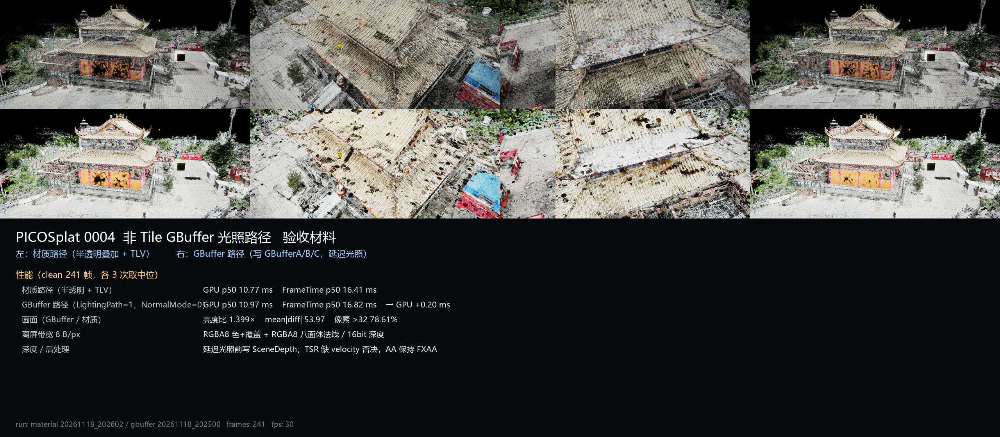

# temple_orbit_360 / temple_visual_gbuffer / 20261118_202500

## 这次 run 是什么

- 用例 `temple_orbit_360_frames_gbuffer`，档位 `visual`，轨迹 `temple_orbit_360`；屏幕百分比 100%，渲染 1782x775。
- 采样 241 帧（warmup 20 帧丢弃），每 1 帧截 1 张共 241 张。
- PICOSplat `4fc0cda`，Docs `c98f89e`。

## 时间与帧率

- 没有提供 clean run，时间与帧率取自本次 run：39.21 s，p50 129.6 ms（8 fps）。
- 拼图每一格的 `+x.xx s` 就是该帧在正常运动中的时刻；`ms` 与 `fps` 是该时刻的帧时间与帧率。

## 覆盖：想要的 splat 实际画了多少

- 全帧平均 `DrawnSplats` **16.4M** / `WantedSplats` **27.4M** = **71.9%**。
- 每帧平均 **275** 个前沿节点未驻留（p95 442，前沿规模均值 504）。
- `UncoveredFrontierNodes` 最大 **0**：没有整块区域连粗层都缺；画面上看到的黑色斑点是黑色背景从欠采样的 splat 缝里透出来。

## 拼图对应的 16 帧

| 帧 | 时刻 | 帧时间 | 帧率 | drawn / wanted | 未驻留 |
| ---: | ---: | ---: | ---: | --- | ---: |
| 0 | +0.00s | 17.3ms | 58fps | 9.0/9.0M (100%) | 0/466 |
| 1 | +0.01s | 17.3ms | 58fps | 9.0/9.0M (100%) | 0/466 |
| 2 | +0.05s | 55.4ms | 18fps | 9.0/9.0M (100%) | 0/466 |
| 22 | +3.72s | 67.8ms | 15fps | 16.6/37.8M (44%) | 455/509 |
| 44 | +7.26s | 84.6ms | 12fps | 16.9/40.2M (42%) | 444/509 |
| 65 | +10.77s | 104.7ms | 10fps | 15.8/12.9M (123%) | 81/510 |
| 80 | +13.19s | 115.3ms | 9fps | 15.2/15.3M (100%) | 163/512 |
| 87 | +14.34s | 115.3ms | 9fps | 14.4/26.4M (54%) | 321/507 |
| 109 | +17.92s | 129.6ms | 8fps | 17.5/40.5M (43%) | 403/499 |
| 131 | +21.41s | 135.0ms | 7fps | 15.4/14.5M (106%) | 164/506 |
| 153 | +24.84s | 137.1ms | 7fps | 16.1/38.6M (42%) | 371/505 |
| 160 | +25.98s | 140.8ms | 7fps | 17.5/40.5M (43%) | 388/504 |
| 175 | +28.60s | 143.8ms | 7fps | 18.4/40.5M (46%) | 390/507 |
| 196 | +31.77s | 145.3ms | 7fps | 17.1/16.3M (105%) | 135/504 |
| 218 | +35.48s | 147.8ms | 7fps | 16.0/24.8M (65%) | 230/506 |
| 240 | +39.07s | 148.6ms | 7fps | 19.6/40.4M (49%) | 403/502 |

## 文件

- `contact_sheet.jpg`：压缩到 1600 px 宽的 16 格拼图。
- `frames.csv`：逐帧数据（时刻、帧时间、帧率、drawn/wanted、未驻留、uncovered）。
