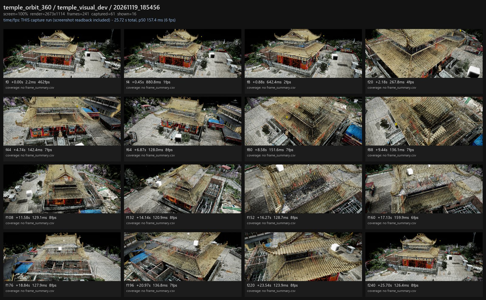

# temple_orbit_360 / temple_visual_dev / 20261119_185456

## 这次 run 是什么

- 用例 `temple_orbit_360_visual_dev`，档位 `visual`，轨迹 `temple_orbit_360`；屏幕百分比 100%，渲染 2673x1114。
- 采样 241 帧（warmup 20 帧丢弃），每 4 帧截 1 张共 61 张。
- PICOSplat `21ce2f6`，Docs `aaec769`。

## 时间与帧率

- 没有提供 clean run，时间与帧率取自本次 run：25.72 s，p50 157.4 ms（6 fps）。
- 拼图每一格的 `+x.xx s` 就是该帧在正常运动中的时刻；`ms` 与 `fps` 是该时刻的帧时间与帧率。

## 覆盖：想要的 splat 实际画了多少

- 全帧平均 `DrawnSplats` **0.0M** / `WantedSplats` **0.0M** = **0.0%**。
- 每帧平均 **0** 个前沿节点未驻留（p95 0，前沿规模均值 0）。
- `UncoveredFrontierNodes` 最大 **0**：没有整块区域连粗层都缺；画面上看到的黑色斑点是黑色背景从欠采样的 splat 缝里透出来。

## 拼图对应的 16 帧

| 帧 | 时刻 | 帧时间 | 帧率 | drawn / wanted | 未驻留 |
| ---: | ---: | ---: | ---: | --- | ---: |
| 0 | +0.00s | 2.2ms | 462fps | 0.0/0.0M (0%) | 0/0 |
| 4 | +0.46s | 880.8ms | 1fps | 0.0/0.0M (0%) | 0/0 |
| 8 | +0.88s | 642.5ms | 2fps | 0.0/0.0M (0%) | 0/0 |
| 20 | +2.17s | 267.8ms | 4fps | 0.0/0.0M (0%) | 0/0 |
| 44 | +4.74s | 142.4ms | 7fps | 0.0/0.0M (0%) | 0/0 |
| 64 | +6.87s | 128.0ms | 8fps | 0.0/0.0M (0%) | 0/0 |
| 80 | +8.58s | 151.6ms | 7fps | 0.0/0.0M (0%) | 0/0 |
| 88 | +9.44s | 136.1ms | 7fps | 0.0/0.0M (0%) | 0/0 |
| 108 | +11.58s | 129.1ms | 8fps | 0.0/0.0M (0%) | 0/0 |
| 132 | +14.13s | 120.8ms | 8fps | 0.0/0.0M (0%) | 0/0 |
| 152 | +16.27s | 128.7ms | 8fps | 0.0/0.0M (0%) | 0/0 |
| 160 | +17.13s | 159.9ms | 6fps | 0.0/0.0M (0%) | 0/0 |
| 176 | +18.84s | 127.9ms | 8fps | 0.0/0.0M (0%) | 0/0 |
| 196 | +20.97s | 136.8ms | 7fps | 0.0/0.0M (0%) | 0/0 |
| 220 | +23.54s | 123.9ms | 8fps | 0.0/0.0M (0%) | 0/0 |
| 240 | +25.70s | 126.3ms | 8fps | 0.0/0.0M (0%) | 0/0 |

## 文件

- `contact_sheet.jpg`：压缩到 1600 px 宽的 16 格拼图。
- `frames.csv`：逐帧数据（时刻、帧时间、帧率、drawn/wanted、未驻留、uncovered）。
