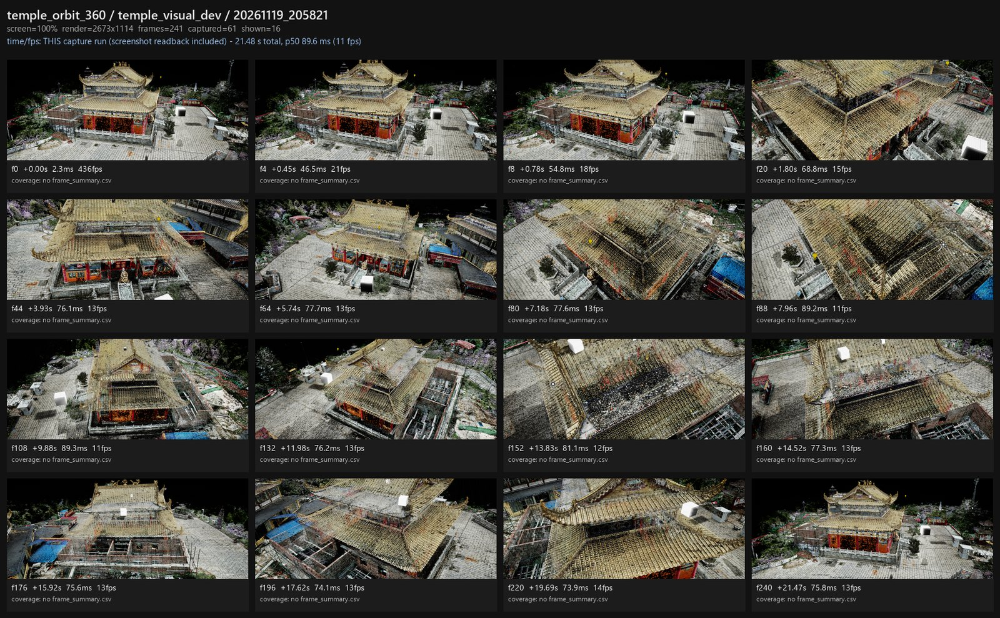

# temple_orbit_360 / temple_visual_dev / 20261119_205821

## 这次 run 是什么

- 用例 `temple_orbit_360_visual_dev`，档位 `visual`，轨迹 `temple_orbit_360`；屏幕百分比 100%，渲染 2673x1114。
- 采样 241 帧（warmup 20 帧丢弃），每 4 帧截 1 张共 61 张。
- PICOSplat `6340469`，Docs `2273f91`。

## 时间与帧率

- 没有提供 clean run，时间与帧率取自本次 run：21.48 s，p50 89.6 ms（11 fps）。
- 拼图每一格的 `+x.xx s` 就是该帧在正常运动中的时刻；`ms` 与 `fps` 是该时刻的帧时间与帧率。

## 覆盖：想要的 splat 实际画了多少

- 全帧平均 `DrawnSplats` **0.0M** / `WantedSplats` **0.0M** = **0.0%**。
- 每帧平均 **0** 个前沿节点未驻留（p95 0，前沿规模均值 0）。
- `UncoveredFrontierNodes` 最大 **0**：没有整块区域连粗层都缺；画面上看到的黑色斑点是黑色背景从欠采样的 splat 缝里透出来。

## 拼图对应的 16 帧

| 帧 | 时刻 | 帧时间 | 帧率 | drawn / wanted | 未驻留 |
| ---: | ---: | ---: | ---: | --- | ---: |
| 0 | +0.00s | 2.3ms | 436fps | 0.0/0.0M (0%) | 0/0 |
| 4 | +0.45s | 46.5ms | 22fps | 0.0/0.0M (0%) | 0/0 |
| 8 | +0.78s | 54.8ms | 18fps | 0.0/0.0M (0%) | 0/0 |
| 20 | +1.80s | 68.8ms | 14fps | 0.0/0.0M (0%) | 0/0 |
| 44 | +3.93s | 76.1ms | 13fps | 0.0/0.0M (0%) | 0/0 |
| 64 | +5.74s | 77.7ms | 13fps | 0.0/0.0M (0%) | 0/0 |
| 80 | +7.18s | 77.6ms | 13fps | 0.0/0.0M (0%) | 0/0 |
| 88 | +7.96s | 89.2ms | 11fps | 0.0/0.0M (0%) | 0/0 |
| 108 | +9.88s | 89.2ms | 11fps | 0.0/0.0M (0%) | 0/0 |
| 132 | +11.98s | 76.2ms | 13fps | 0.0/0.0M (0%) | 0/0 |
| 152 | +13.83s | 81.1ms | 12fps | 0.0/0.0M (0%) | 0/0 |
| 160 | +14.52s | 77.3ms | 13fps | 0.0/0.0M (0%) | 0/0 |
| 176 | +15.92s | 75.6ms | 13fps | 0.0/0.0M (0%) | 0/0 |
| 196 | +17.62s | 74.1ms | 14fps | 0.0/0.0M (0%) | 0/0 |
| 220 | +19.69s | 73.9ms | 14fps | 0.0/0.0M (0%) | 0/0 |
| 240 | +21.47s | 75.8ms | 13fps | 0.0/0.0M (0%) | 0/0 |

## 文件

- `contact_sheet.jpg`：压缩到 1600 px 宽的 16 格拼图。
- `frames.csv`：逐帧数据（时刻、帧时间、帧率、drawn/wanted、未驻留、uncovered）。
