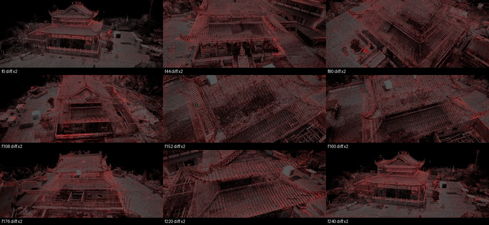

# C1 motion comparison (baseline vs C1)

- Left: baseline 20261119_185456.
- Right: C1 20261119_205821.
- 61 full-resolution frames (2673x1114), every 4 trajectory frames, played at 7.5 fps to approximate real time.
- This is a sampled comparison; per-frame flicker is not fully represented. The 30 fps screen capture is in run 20261119_210216.
- The image shows the C1-vs-baseline difference (amplified x2).

[replay.mp4](replay.mp4)

